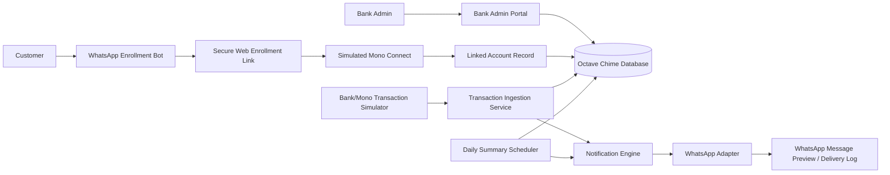

# Octave Chime Implementation Plan

## 1. Product Definition

Octave Chime is a Nigerian multi-bank SaaS web application that lets banks offer WhatsApp as a third transaction-notification channel alongside SMS and email.

For the demo/prototype, each bank is onboarded into Octave Chime as a tenant. Customers start enrollment from WhatsApp, choose their bank, give consent, receive a secure web link, complete a simulated Mono Connect account-linking flow, and then receive WhatsApp-style transaction alerts and daily balance summaries.

The product must be built as a production-shaped MVP: demo-ready by the deadline, but architected so real Mono, WhatsApp Cloud API, and direct bank integrations can be added later without rewriting the system.

## 2. Core Product Promise

For banks:

- Add WhatsApp as a transaction-alert channel.
- Manage customers who opted into WhatsApp alerts.
- Monitor linked accounts, alert status, message delivery, and summaries.
- Offer a modern notification option without rebuilding their core banking system.

For customers:

- Start enrollment inside WhatsApp.
- Complete sensitive account-linking steps on a secure web page, not inside WhatsApp.
- Link a bank account through a Mono-style consent flow.
- Receive debit and credit alerts on WhatsApp.
- Receive automatic daily opening/closing balance summaries at the configured end-of-day time, default 9:00 PM.
- Pause, resume, stop, or restart the service from WhatsApp.

## 3. Product Boundaries

### Included in This MVP

- Multi-bank onboarding.
- Bank admin login/dashboard.
- WhatsApp enrollment bot simulation.
- Secure customer enrollment link.
- Simulated Mono Connect flow.
- Secure customer linking/status page only; no full customer dashboard in the MVP.
- Transaction feed.
- Balance display inside transaction alerts and daily summaries.
- WhatsApp pause/resume/stop/restart controls.
- WhatsApp-style message preview/delivery log.
- Automatic scheduled daily summary generation.
- Audit log foundation.
- Adapter-based architecture for future real integrations.
### Excluded From This MVP

- Money transfers.
- Bill payments.
- Card controls.
- Free-form customer questions through WhatsApp.
- PIN, password, OTP, CVV, or full card/account credential collection.
- Live production banking data unless a real API provider grants access.
- Full sensitive account registration inside chat.

## 4. Recommended Technology Stack

Use a web app stack that can move quickly but still look credible for a fintech SaaS.

### Frontend

- React with Next.js.
- TypeScript.
- Tailwind CSS or a clean component system.
- Recharts or Tremor-style chart components for bank/admin analytics.
- Lucide icons for interface icons.

### Backend

- Next.js API routes/server actions for the MVP, or Express/Fastify if the repo already uses a separate Node backend.
- TypeScript throughout.
- PostgreSQL as the production database target.
- Prisma as ORM.
- Redis/BullMQ or a simple scheduled job layer for summaries and retries.

### Integrations

- Mono adapter:
  - MVP: simulated Mono Connect.
  - Future: real Mono Connect and transaction APIs.

- WhatsApp adapter:
  - MVP: simulated WhatsApp message delivery and preview.
  - Future: WhatsApp Business Platform/Cloud API.

### Authentication

- MVP: email/password or seeded demo users.
- Production target: bank admin authentication with roles and MFA.
- Customer access: secure magic link or password login.

### Deployment Target

- Vercel or Render for demo deployment.
- Managed PostgreSQL provider such as Supabase, Neon, Railway, or Render Postgres.

## 5. High-Level System Diagram



## 6. Real-World Integration Model

There are two future production integration paths.

### Path A: Customer-Consented Aggregator Model

1. Bank is onboarded on Octave Chime.
2. Customer starts opt-in through WhatsApp.
3. Customer receives a secure web link and links their account through Mono.
4. Octave Chime reads account and transaction data through Mono with customer consent.
5. Octave Chime sends WhatsApp transaction alerts.

This is the best model for the demo because it can be simulated cleanly.

### Path B: Direct Bank Integration Model

1. Bank is onboarded on Octave Chime.
2. Bank connects its transaction event API or webhook.
3. Bank sends real-time transaction events directly to Octave Chime.
4. Octave Chime handles WhatsApp notification preferences, delivery, retries, logs, and summaries.

This is likely the strongest long-term enterprise model.

The MVP should implement Path A visually and structurally, while keeping the adapter architecture flexible enough for Path B.

## 7. Main User Roles

### Platform Admin

The Octave Chime internal owner.

Can:

- Create banks.
- View all tenants.
- Monitor all message delivery.
- Configure global integration settings.

This role can be minimal in the first demo.

### Bank Admin

The bank-side user.

Can:

- Log into a bank dashboard.
- View bank profile.
- View enrolled customers.
- Add or invite customers.
- See linked account status.
- See WhatsApp alert status.
- See recent transactions and message delivery logs.
- Trigger demo transactions.
- Run the daily summary scheduler manually for demo/testing.

### Customer

The bank customer who opts into WhatsApp alerts.

Can:

- Complete enrollment.
- Confirm WhatsApp phone number.
- Simulate account linking through Mono Connect.
- View account balance.
- Receive transaction alerts in WhatsApp.
- Use WhatsApp commands/buttons to pause, resume, stop, and restart the service.
- Complete secure re-consent through a web link if they previously opted out.
- Receive automatic daily summaries at the bank/customer configured end-of-day time.

## 8. Required Screens

The demo should have four main screen groups.

### Screen Group 1: Bank Onboarding and Admin Login

Purpose:

Allow a bank to exist as a tenant and let a bank admin manage its customers.

Pages:

- Landing/login page.
- Bank selection or seeded demo login page.
- Bank admin dashboard.
- Bank profile/settings page.

Bank admin dashboard must show:

- Bank name and logo.
- Number of enrolled customers.
- Number of linked accounts.
- Number of WhatsApp-enabled customers.
- Alerts sent today.
- Failed alerts.
- Daily summaries sent.
- Recent customer enrollments.
- Recent delivery log.

Seed demo banks:

- Zenith Bank
- Access Bank
- GTBank
- UBA

### Screen Group 2: WhatsApp Enrollment Bot Simulation

Purpose:

Let a customer start opt-in from WhatsApp, choose their bank, grant consent, and receive a secure web link for account linking.

WhatsApp bot flow:

- Customer sends START.
- Bot welcomes customer and states safety rules.
- Customer chooses bank.
- Customer provides or confirms basic identity details.
- Customer confirms WhatsApp phone number from the chat context.
- Customer accepts consent.
- Bot generates a secure enrollment link.
- Customer opens the secure web link to continue account linking.

Consent text should say, in simple terms:

- The customer agrees to receive transaction alerts and daily balance summaries on WhatsApp.
- The customer understands that sensitive credentials should never be shared on WhatsApp.
- The customer understands that account linking happens on a secure web page, not inside WhatsApp.
- The customer can pause or revoke alerts.

After WhatsApp consent:

- Create customer profile.
- Store enrollment source as whatsapp.
- Mark enrollment status as "Pending account link".
- Generate a short-lived secure enrollment link.
- Show the link in the WhatsApp-style chat simulation.
- Opening the link should route to the secure web account-linking flow.

### Screen Group 3: Simulated Mono Connect

Purpose:

Simulate customer-consented account linking.

Flow:

1. Show Mono-style connect modal/page.
2. Customer chooses bank.
3. Customer chooses a demo account.
4. Customer authorizes access.
5. System creates linked account record.
6. System creates opening balance and sample transactions.
7. Return customer to WhatsApp confirmation/status page.

Important:

- Do not ask for real banking credentials.
- Label this as "Demo account linking" or "Simulated secure account linking".
- The design should make it clear that real production access would be handled by a regulated provider such as Mono or by a direct bank integration.

Demo accounts:

- Zenith Bank account ending 1029, balance NGN 100,000.
- Access Bank account ending 4421, balance NGN 250,000.
- GTBank account ending 8810, balance NGN 75,000.
- UBA account ending 2104, balance NGN 180,000.

### Screen Group 4: WhatsApp Customer Controls and Secure Status Page

Purpose:

Keep the customer experience inside WhatsApp as much as possible. The customer should not need a full web dashboard in the MVP. The web is used only for secure account linking, re-consent, and lightweight status confirmation.

WhatsApp customer controls:

- `PAUSE`: temporarily stop transaction alerts and daily summaries.
- `RESUME`: turn alerts and daily summaries back on after a pause.
- `STOP`: opt out of the service completely.
- `START`: begin enrollment or restart opt-in after opting out.
- `HELP`: show supported commands and safety rules.
- `PRIVACY`: show consent, data-use, and safety information.
- `RELINK`: generate a secure web link to reconnect the account.

Customer states:

- `pending_link`: customer started WhatsApp enrollment but has not linked account.
- `active`: customer has linked account and receives alerts/summaries.
- `paused`: customer temporarily stopped alerts but remains enrolled.
- `opted_out`: customer revoked the service and should receive no alerts/summaries.
- `link_expired`: customer's secure enrollment/relink link expired.

Pause flow:

1. Customer sends `PAUSE`.
2. Bot asks for confirmation.
3. If confirmed, set service status to `paused`.
4. Stop transaction alerts and daily summaries.
5. Bank dashboard shows customer as paused.

Resume flow:

1. Customer sends `RESUME`.
2. If the customer is `paused`, reactivate alerts immediately.
3. If the customer is `opted_out`, do not reactivate immediately; send a secure re-consent link.

Stop/opt-out flow:

1. Customer sends `STOP`.
2. Bot asks: "Are you sure you want to stop WhatsApp transaction alerts for this linked account?"
3. If confirmed, set service status to `opted_out`.
4. Stop all transaction alerts and automatic daily summaries.
5. Keep minimal audit records required for compliance and bank reporting.
6. Bank dashboard shows customer as opted out.

Opt-back-in flow:

1. Customer sends `START` after previously opting out.
2. Bot recognizes their WhatsApp number and previous bank/customer record.
3. Bot explains that reactivation requires fresh consent.
4. Bot sends a short-lived secure re-consent link.
5. Customer opens the link and confirms consent on the web.
6. If the previous linked account is still valid, reactivate it.
7. If the link/provider authorization is expired, send the customer through simulated Mono Connect again.
8. Bot confirms that WhatsApp alerts and automatic daily summaries are active again.

Secure status page:

The secure web page should show only what is needed to complete or confirm security-sensitive actions:

- Bank name.
- Customer name.
- Masked account number.
- Consent status.
- Service status.
- Account-linking status.
- Final confirmation button.

The secure status page should not become a full transaction-history dashboard in the MVP.
## 9. Demo Flow for Presentation

The presentation should follow this exact sequence.

1. Open Octave Chime.
2. Explain that banks can add WhatsApp as a notification channel.
3. Log in as a bank admin.
4. Show the bank dashboard.
5. Show that there are multiple banks in the system.
6. Open the WhatsApp enrollment bot simulation.
7. Customer sends START.
8. Customer chooses their bank.
9. Bot explains safety rules and asks for consent.
10. Bot creates a pending customer and generates a secure enrollment link.
11. Open the secure enrollment link.
12. Proceed to simulated Mono Connect.
13. Select the customer's bank and demo account.
14. Authorize access.
15. Return to WhatsApp and show confirmation that alerts are active.
16. Show the bank dashboard with the customer marked active.
17. Trigger a demo debit transaction.
18. Show the WhatsApp-style alert generated immediately.
19. Trigger a demo credit transaction.
20. Show the WhatsApp-style alert generated immediately.
21. Run the admin-only daily summary job to simulate the automatic 9 PM scheduler.
22. Show opening balance, total debits, total credits, and closing balance.
23. Demonstrate STOP, then START, showing that opt-back-in requires a secure re-consent link.
24. Return to bank dashboard and show delivery logs/status updated.

## 10. Data Model

Implement these core entities.

### Bank

Fields:

- id
- name
- slug
- logoUrl
- supportEmail
- status
- createdAt
- updatedAt

### BankAdmin

Fields:

- id
- bankId
- name
- email
- passwordHash or demoAuthToken
- role
- createdAt
- updatedAt

### Customer

Fields:

- id
- bankId
- fullName
- email
- whatsappPhone
- consentStatus
- enrollmentStatus
- whatsappAlertsEnabled
- dailySummaryEnabled
- preferredSummaryTime, default 21:00 Africa/Lagos
- createdAt
- updatedAt

Service status values:

- pending_link
- active
- paused
- opted_out
- link_expired

### LinkedAccount

Fields:

- id
- customerId
- bankId
- provider
- providerAccountId
- accountName
- accountNumberMasked
- accountType
- currency
- currentBalance
- openingBalanceToday
- linkedAt
- status

Provider values:

- mono_simulated
- mono_live
- direct_bank_api

### Transaction

Fields:

- id
- bankId
- customerId
- linkedAccountId
- type
- amount
- currency
- balanceAfter
- narration
- reference
- transactionDate
- source
- createdAt

Type values:

- debit
- credit

Source values:

- simulated
- mono
- direct_bank

### Notification

Fields:

- id
- bankId
- customerId
- transactionId
- type
- channel
- status
- recipient
- messageBody
- providerMessageId
- errorMessage
- sentAt
- createdAt

Type values:

- transaction_alert
- daily_summary

Channel values:

- whatsapp
- email
- sms

Status values:

- queued
- sent
- failed
- skipped

### DailySummary

Fields:

- id
- bankId
- customerId
- linkedAccountId
- summaryDate
- openingBalance
- totalCredits
- totalDebits
- closingBalance
- transactionCount
- notificationId
- createdAt

### AuditLog

Fields:

- id
- bankId
- actorType
- actorId
- action
- metadata
- createdAt

## 11. Service Layer Design

Build the application around services/adapters so demo logic does not get mixed into UI components.

### Bank Service

Responsibilities:

- Create/list banks.
- Fetch bank dashboard metrics.
- Isolate data by bank.

### Customer Service

Responsibilities:

- Create customer enrollment.
- Update customer preferences.
- Fetch customer enrollment, linking, and service-status data.
- Enforce customer belongs to selected bank.

### Account Linking Service

Responsibilities:

- Start simulated Mono Connect session.
- Complete simulated account link.
- Create linked account.
- Seed demo transactions.

Future live methods:

- startMonoConnect()
- exchangeMonoCode()
- fetchMonoAccount()
- fetchMonoTransactions()

### Transaction Service

Responsibilities:

- Create simulated debit/credit transactions.
- Update account balance.
- Fetch transactions by customer/account.
- Trigger notification after transaction creation.

### Notification Service

Responsibilities:

- Decide whether a message should be sent.
- Render message templates.
- Queue or create notification record.
- Send through WhatsApp adapter.
- Track success/failure.

### Summary Service

Responsibilities:

- Run automatically at the configured end-of-day time, default 9:00 PM Africa/Lagos.
- Find active customers with daily summaries enabled.
- Skip paused, opted-out, pending-link, and expired-link customers.
- Calculate daily opening balance.
- Calculate total credits/debits.
- Calculate closing balance.
- Create daily summary record.
- Send WhatsApp daily summary automatically.
- Prevent duplicate summaries for the same customer/date.
### WhatsApp Adapter

MVP methods:

- sendTransactionAlert()
- sendDailySummary()

MVP behavior:

- Save a notification record.
- Mark status as sent.
- Display message in WhatsApp-style preview/log.

Future live behavior:

- Call WhatsApp Business Platform/Cloud API.
- Use approved templates.
- Store provider message ID.
- Handle delivery webhooks.

## 12. Message Templates

Use clear and bank-safe wording.

### Debit Alert

```text
Debit Alert
NGN {amount} left your {bankName} account ending {accountLast4}.
Balance: NGN {balanceAfter}
Ref: {reference}
```

### Credit Alert

```text
Credit Alert
NGN {amount} entered your {bankName} account ending {accountLast4}.
Balance: NGN {balanceAfter}
Ref: {reference}
```

### Daily Summary

```text
Daily Summary - {date}
Opening balance: NGN {openingBalance}
Total credits: NGN {totalCredits}
Total debits: NGN {totalDebits}
Closing balance: NGN {closingBalance}
Transactions: {transactionCount}
```

### Alert Disabled Message

```text
WhatsApp alerts are currently paused for this account.
You can turn them back on from your Octave Chime dashboard.
```

Do not include:

- Full account number.
- BVN.
- PIN.
- OTP.
- Card number.
- Password.

## 13. Security Requirements

Even in demo mode:

- Mask account numbers.
- Never request real bank credentials.
- Never collect PINs, OTPs, BVNs, CVVs, or card numbers.
- Store customer phone numbers carefully.
- Keep tenant data separated by bankId.
- Add audit logs for enrollment, account linking, preference changes, and notification sends.
- Validate that a bank admin can only view their own bank's customers.
- Validate that a customer can only view their own dashboard.
- Use environment variables for secrets.
- Keep integration keys out of the frontend.

Production target:

- Encrypt sensitive fields at rest.
- Use MFA for bank admins.
- Use signed webhooks for bank/provider events.
- Use rate limiting.
- Use background queues for retries.
- Add monitoring and alerting.
- Complete NDPA-aligned privacy review.

### WhatsApp Enrollment Security Rules

Inside WhatsApp, the bot may collect or confirm only low-risk enrollment information:

- Bank selection.
- Consent to receive alerts.
- Basic name confirmation if needed.
- Request to pause, resume, stop, restart, or relink alerts.

Inside WhatsApp, the bot must never ask for:

- Bank password.
- PIN.
- BVN.
- OTP sent by the bank.
- Full account number.
- Card number.
- CVV.

The WhatsApp bot should always move the customer to a secure web page for account linking.
## 14. Implementation Sequence

Follow this sequence exactly.

### Phase 1: Project Setup

1. Confirm existing project framework.
2. If no app exists, create a Next.js TypeScript app.
3. Add styling system.
4. Add database/ORM setup.
5. Add environment file template.
6. Add seed data command.
7. Add basic layout/navigation.

### Phase 2: Data Layer

1. Define schema for Bank, BankAdmin, Customer, LinkedAccount, Transaction, Notification, DailySummary, and AuditLog.
2. Add migrations.
3. Seed demo banks.
4. Seed demo admin users.
5. Seed optional demo customers.

### Phase 3: Bank Admin Flow

1. Build login or demo bank selector.
2. Build bank admin dashboard.
3. Show bank metrics.
4. Show enrolled customers table.
5. Show recent notifications table.
6. Add action to enroll a new customer.

### Phase 4: WhatsApp Enrollment Bot Simulation

1. Build WhatsApp-style chat enrollment screen.
2. Support START command or start button.
3. Show safety message that Octave Chime will never ask for PIN, BVN, OTP, card details, or banking password.
4. Let customer choose a bank.
5. Capture basic customer identity details needed for the demo.
6. Capture consent for WhatsApp transaction alerts and daily summaries.
7. Create customer as pending account link.
8. Generate secure enrollment link.
9. Show the link inside the WhatsApp-style chat.
10. Route the link to simulated Mono Connect.
### Phase 5: Simulated Mono Connect

1. Build Mono-style connection screen.
2. Show selected bank and available demo accounts.
3. Let customer authorize account access.
4. Create linked account.
5. Seed or generate opening transactions.
6. Mark customer enrollment as active.
7. Return customer to WhatsApp confirmation/status page.

### Phase 6: WhatsApp Customer Controls and Secure Status Page

1. Build WhatsApp command handling for `PAUSE`, `RESUME`, `STOP`, `START`, `HELP`, `PRIVACY`, and `RELINK`.
2. Implement confirmation prompts for `PAUSE` and `STOP`.
3. Implement immediate resume for paused customers.
4. Implement secure re-consent link for customers who previously opted out.
5. Build a lightweight secure status page for account-linking/re-consent confirmation.
6. Ensure the secure status page does not become a full transaction-history dashboard.
7. Show customer service status in the bank admin dashboard.
### Phase 7: Transaction Simulation

1. Add "Trigger Debit" demo action.
2. Add "Trigger Credit" demo action.
3. Update account balance after transaction.
4. Create transaction record.
5. Trigger notification service.
6. Show generated WhatsApp message.

### Phase 8: Notification Service

1. Implement message rendering.
2. Implement notification record creation.
3. Respect WhatsApp alert toggle.
4. Mark notification as sent in demo mode.
5. Show delivery status in customer and bank dashboards.

### Phase 9: Automatic Daily Summary

1. Implement a scheduled summary job that runs at the configured end-of-day time, default 9:00 PM Africa/Lagos.
2. Find active customers with linked accounts and daily summaries enabled.
3. Skip customers who are paused, opted out, pending account link, or link expired.
4. Calculate opening balance.
5. Calculate total credits and debits.
6. Calculate closing/current balance.
7. Create daily summary record.
8. Generate WhatsApp-style summary message automatically.
9. Show summary in notification log.
10. Prevent duplicate summaries for the same customer/date.
11. Add an admin-only "Run Daily Summary Now" demo action to simulate the scheduled 9 PM job during presentation.
### Phase 10: Polish and Demo Readiness

1. Improve UI copy.
2. Add empty states.
3. Add loading states.
4. Add error states.
5. Confirm mobile responsiveness.
6. Add demo script data.
7. Test full presentation flow end to end.
8. Fix any confusing labels.

## 15. UI Direction

The interface should feel like a serious fintech operations product, not a marketing landing page.

Design principles:

- Clean, restrained, professional.
- Dashboard-first.
- Clear hierarchy.
- No oversized hero sections.
- No decorative gradients as the main design idea.
- Use charts and operational tables.
- Use WhatsApp green only as an accent for notification status, not the whole theme.
- Use bank logos/names as clear tenant context.

Suggested navigation:

- Overview
- Customers
- Transactions
- Notifications
- Settings

Customer-facing navigation:

The MVP should not include a full customer dashboard. Customer actions should happen in WhatsApp. The only customer-facing web surface should be a secure linking/re-consent/status page.

Secure status page content:

- Bank name.
- Masked account.
- Service status.
- Consent status.
- Account-linking status.
- Continue/confirm button when needed.
## 16. Demo Data

Create seed data for:

### Banks

- Zenith Bank
- Access Bank
- GTBank
- UBA

### Customers

- Adaeze Okafor, Zenith Bank
- Tunde Balogun, Access Bank
- Chiamaka Eze, GTBank
- Ibrahim Musa, UBA

### Transactions

Use realistic Nigerian transaction narrations:

- POS PURCHASE - SUPERMARKET
- TRANSFER TO JOHN A.
- SALARY CREDIT
- AIRTIME PURCHASE
- ELECTRICITY BILL
- RESTAURANT PAYMENT
- BANK TRANSFER FROM EMEKA O.

## 17. Acceptance Criteria

The application is complete enough for demo when:

- A bank admin can log in or select a demo bank.
- The bank dashboard shows real seeded metrics.
- A new customer can be enrolled.
- The customer can complete simulated Mono Connect.
- A linked account is created.
- The secure status page confirms linked account status without becoming a full transaction-history dashboard.
- WhatsApp alerts can be paused, resumed, stopped, and restarted through WhatsApp commands/buttons.
- A debit transaction creates a debit alert.
- A credit transaction creates a credit alert.
- Daily summaries are generated automatically by the scheduled summary job.
- An admin-only demo action can run the daily summary job immediately for presentation.
- Paused and opted-out customers do not receive transaction alerts or daily summaries.
- A paused customer can resume from WhatsApp.
- An opted-out customer must use a secure re-consent link before opt-back-in is completed.
- Notification logs update after alerts.
- Bank admin can see customer and notification activity.
- No real banking credentials are requested.
- Account numbers are masked.
- The full demo flow works without manual database edits.

## 18. Stretch Goals

Only attempt these after the core flow works.

- Real WhatsApp Cloud API sandbox/test number.
- Real Mono sandbox integration.
- Email fallback notification.
- Real customer opt-out and opt-back-in through WhatsApp commands and secure re-consent links.
- CSV export for bank admins.
- Role-based permissions.
- Webhook endpoint skeleton.
- Background queue for notifications.
- Delivery retry simulation.

## 19. Final Demo Script

Use this script for the live presentation.

```text
Octave Chime helps Nigerian banks offer WhatsApp as a secure transaction-alert channel.

Today, banks mostly send alerts through SMS and email. Octave Chime adds WhatsApp as a third option.

First, a bank is onboarded into the platform. Here is Zenith Bank's admin dashboard. The bank can see customers who opted into WhatsApp alerts, linked accounts, alert delivery, service status, and summary status.

Now the customer starts enrollment from WhatsApp by sending START. The bot explains the safety rules, asks the customer to choose their bank, captures consent, and sends a secure enrollment link.

The customer opens that secure link to link their bank account. For this demo, we are using a simulated Mono Connect flow. In production, this can connect through Mono, an approved open-banking provider, or a direct bank API.

Once the account is linked, the customer returns to WhatsApp. The customer does not need a full dashboard; WhatsApp is the main interface, and the secure web page is only used for linking or re-consent.

Now we simulate a debit transaction. The balance updates, and a WhatsApp debit alert is generated immediately.

Now we simulate a credit transaction. Again, the balance updates, and the alert is generated.

At the configured end-of-day time, default 9 PM, Octave Chime automatically calculates opening balance, total credits, total debits, closing balance, and sends a WhatsApp daily summary. For the demo, the bank admin can run that scheduled job immediately.

Finally, the customer can send STOP to opt out. If they later send START again, Octave Chime requires a secure re-consent link before reactivating the service.

This proves the core product flow: bank onboarding, WhatsApp-first customer enrollment, secure account linking, transaction detection, WhatsApp alerts, automatic daily summaries, opt-out, and secure opt-back-in.
```

## 20. Build Priority

If time becomes tight, prioritize in this order:

1. Bank admin dashboard.
2. WhatsApp enrollment bot simulation.
3. Secure customer enrollment link.
4. Simulated Mono Connect.
5. WhatsApp customer controls and secure status page.
6. Transaction simulation.
7. WhatsApp alert preview/log.
8. Automatic daily summary scheduler.
9. Visual polish.
10. Real external API attempts.
Do not spend time on real API integration until the complete demo loop works locally.


